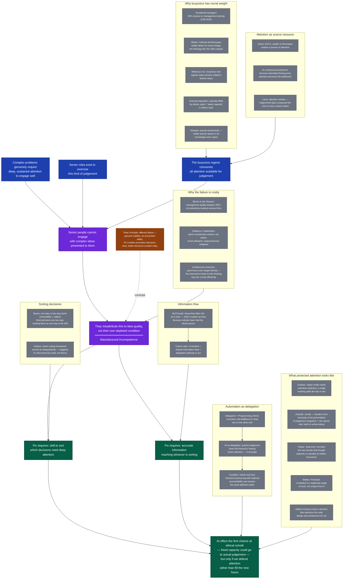

Core spine in **blue/purple**, side quests in **grey**, resolution in **green**. Dashed lines are contrasts, not support.

---

## Reading the map

**Core spine** (blue/purple → green): The argument runs in a straight chain — complex problems need attention; senior roles exist to provide it; busyness consumes it; therefore the judgement fails; the failure is misread as the idea's problem; fixing it requires two simultaneous conditions; AI offers a rare opening.

**Side quests** (grey): Each supports a specific node on the spine but doesn't change the logical chain if removed. They answer *why* busyness has its grip (Weber, Bellezza, CMI), *why* attention is the real scarcity (Simon, Leroy), *how* you would actually implement the two fixes (Bezos, McChrystal), and *what* protecting attention looks like in practice (Graham, Aristotle, Wallas).

**Contrast node** (brown, dashed): The Peter Principle is deliberately distinguished — it's a different diagnosis, included to sharpen rather than support the main claim.

---

## Which sections are side quests?

| Essay section | Role |
|---|---|
| *How it is built* (accidental managers) | Side quest → supports P3 (how busyness gets imposed) |
| *Why the anxiety comes out as busyness* (Weber, Bellezza, Newport) | Partly core (external imposition), partly side quest (genealogy/status) |
| *Which decisions are yours* (Bezos, Collison) | Core — direct support for S1 |
| *Getting the information to the decision* (McChrystal, fusion cells) | Core — direct support for S2 |
| *The maker who forgot they were a maker* (Graham, Leroy, alienation) | Side quest → supports RES |
| *What leisure was for* (Aristotle, Pieper, Wallas, architecture) | Side quest → supports RES; most tangential section |
| *What it costs, and to whom* (Bloom, DeMarco, Leibenstein, fixed fee) | Side quest → supports MC (stakes of the failure) |
